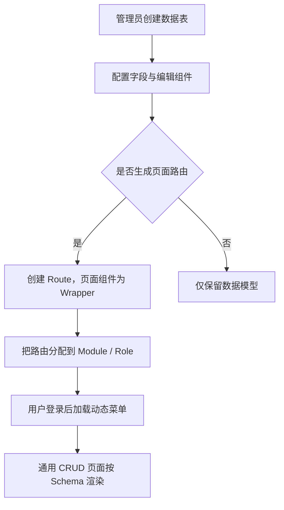

# 系统使用文档

> 本文档以当前代码实际启用的架构为准：Vue 管理端通过 `/api` 调用 Express BFF，BFF 在服务端访问 Parse Server 和 PostgreSQL。历史 `controller/`、`routes/admin/`、`routes/cmn/` 等代码未由当前 `app-factory.js` 挂载，不能作为新接入依据。

## 局域网 IPC 摄像头管理

入口已升级为独立「摄像头管理」模块：组织管理、设备管理、成员管理、视频中心。设备地址为 `/camera/devices`，旧 `/system/camera` 保留跳转。执行 `npm run migrate:camera` 新增视频组织、成员、个人视图和审计表；配置 `CAMERA_ENCRYPTION_KEY`（32 字节随机密钥的 Base64）、`CAMERA_FFMPEG_PATH`（含 libx264 的 FFmpeg）后重启，管理员刷新菜单可补齐四个入口并在岗位中分别分配权限。

先创建公司→组织→门店树，为设备设置组织归属，再关联企业成员或创建视频查看账号并配置其归属组织与下级访问范围。视频中心左上显示组织树，左下显示组织设备，右侧支持任意1–16分屏、拖拽放置、全屏、暂停/恢复、断线重试和个人监控视图。`CAMERA_MAX_LIVE_STREAMS` 默认32，独立于默认8路录像额度。操作步骤、升级注意事项及权限边界见 [摄像头独立模块指南](CAMERA_WORKSPACE_GUIDE.md)。

1. 点击「扫描局域网」发现 BFF 所在局域网内响应 ONVIF 的设备，选择关联；也可手动填写 IPv4、端口、本地账号密码及 RTSP 相对路径。
2. 在「配置」中修改名称、安装位置或连接信息。保存后可读取 ONVIF 通道并选择路径再保存；编辑密码留空保留原值。
3. 在「封面」上传不超过 512 KiB 的 JPEG/PNG/WebP，或确认清除现有封面。
4. 点击「实时预览」打开受鉴权的 H.264 HLS 画面。关闭窗口释放转码进程，设备密码不会进入播放 URL。
5. 开启「服务器持续录像」，等待约五分钟完成首段，在「录像回放 → 服务器本地录像」刷新并播放；支持进度拖动。默认保留七天、总配额 10240 MiB，超过保留期/配额自动删除最旧完整录像。
6. 在「设备 SD 卡 / NVR 历史录像」读取录像服务，选择 Profile G token 或海康/大华厂商回放、通道与过去的一小时以内区间；大华需要设备实际时区偏移（中国标准时间 480 分钟）。

摄像头访问范围以服务器的 `CAMERA_ALLOWED_CIDRS` 为准，留空只允许服务器直连私网；发现不跨 VLAN 时可手动填写。海康、大华、部分萤石及开放本地协议的小米型号可接入，**仅提供厂商云协议的设备无法纯本地接入**。设备历史录像还需 Profile G 或已支持的厂商回放接口。当前不保留音频，服务器分段录像在断线、重配置或重启时可能有缺口，不替代专业 NVR 连续录像保证。

完整配置项、步骤、品牌限制、部署边界、排错及验证命令见 [局域网 IPC 摄像头接入与回放](IPC_CAMERA_GUIDE.md)。

## 1. 系统概览

Shumian Vue Admin 是一个以 **Schema（数据表元数据）+ Module（模块）+ Route（路由）+ Role/AllotPermission（权限）** 为核心的低代码管理平台。

管理员完成表结构与页面配置后，前端会依据元数据动态装配菜单、路由、筛选表单、数据列表和编辑弹窗；业务数据通过 BFF 统一进行认证、授权和租户隔离。



## 2. 使用前准备

### 2.1 管理员初始化

首次部署前，在后端 `admin_server/.env` 中设置：

- `INITIAL_ADMIN_USERNAME`：首个管理员账号。
- `INITIAL_ADMIN_PASSWORD`：生产环境至少 12 位、唯一的强密码；本地开发环境可使用测试密码。
- `DATABASE_URI`、`PARSE_APP_ID`、`PARSE_MASTER_KEY`、`AUTH_JWT_SECRET`：后端机密配置。

后端启动后，在受控终端执行 `npm run seed:initial`。项目不会在版本库中提供或保留固定默认账号与密码；本地开发使用的账号配置只应保存在被 Git 忽略的 `admin_server/.env` 中。

### 2.2 运行地址

| 服务 | 默认地址 | 用途 |
| --- | --- | --- |
| 前端开发服务器 | `http://localhost:4200`、`http://<局域网IP>:4200` | Vue 管理端；开发服务器监听所有网络接口，局域网设备可使用运行主机的局域网 IP 访问。 |
| 后端 BFF | `http://localhost:3000` | 浏览器访问的 API。 |
| 健康检查 | `http://localhost:3000/healthz` | 返回服务状态与请求 ID。 |
| 内部 Parse Server | `http://127.0.0.1:1337/parse` | 仅后端内部使用，禁止公网暴露。 |

前端开发环境会将 `/api` 代理到后端。通过局域网地址访问时，将后端 `admin_server/.env` 的 `PUBLIC_ORIGIN` 和 `CORS_ORIGINS` 设置为实际前端地址（例如 `http://192.168.1.20:4200`），重启后端后再登录；若 Windows 防火墙拦截 Node.js，请允许 TCP `4200` 入站。生产环境建议前端和 API 位于同一受信任域名，并由反向代理把 `/api` 转发至后端。

### 2.3 首页天气与位置服务配置

首页的位置服务依赖高德地图 Web JS API Key。设置方式：

1. 开发环境：在 `vue_admin/.env.local` 中设置 `VUE_APP_MAP_KEY`。
2. 已构建的生产环境：在 `vue_admin/public/config.js`（构建后为 `dist/config.js`）中设置 `mapKey`。
3. 在高德开放平台为该 Key 配置允许来源域名。

首页天气默认读取 `public/config.js` 中的 `weather` 对象，默认值为北京坐标和 Open-Meteo 无密钥天气服务：

| 配置项 | 说明 |
| --- | --- |
| `weather.apiBase` | 天气服务地址，默认 `https://api.open-meteo.com/v1/forecast`。 |
| `weather.ipApi` | 设备定位失败后的 IP 城市定位接口，默认 `https://ipapi.co/json/`；只能配置浏览器可访问的公开接口。 |
| `weather.latitude` / `weather.longitude` | 城市坐标，单位为十进制度。 |
| `weather.location` | 首页显示的城市名称。 |

运行时配置只能保存浏览器安全值。企业部署可替换为已完成隐私、网络出口与 SLA 评审的天气服务；切勿在此文件写入任何 API 密钥或服务端机密。未配置地图 Key 或天气服务不可达时，对应卡片会安全降级，不影响登录、菜单和业务数据操作。

## 3. 登录、会话与基础操作

### 3.1 登录

1. 打开管理端，输入管理员或已授权用户的账号与密码。
2. 系统调用 `POST /api/auth/login` 验证身份。
3. 登录成功后，服务端写入 `HttpOnly`、`SameSite=Strict` 会话 Cookie，并把 CSRF 令牌、安全的用户/公司/角色上下文返回给页面。
4. 前端依据用户已分配的模块、路由和权限加载菜单。

默认会话有效期为 30 天（`AUTH_TTL_SECONDS=2592000`）。每次通过认证的有效 API 请求都会重新签发同一会话的 Cookie，把过期时间滑动到当前时间之后；因此用户持续操作时无需重复登录，连续 30 天没有有效操作才会要求重新登录。生产环境会启用 `Secure`，Cookie 保持 `HttpOnly`、`SameSite=Strict` 和根路径作用域。前端只保存 CSRF 令牌和脱敏用户上下文，不保存或读取会话 Token。

账号必须属于一个有效的 Company。被标记为不可用的账号、没有 Company 的账号或无法获得角色上下文的账号不能正常使用系统。

### 3.2 首页企业工作台

登录后进入首页，系统展示当前账号在当前租户内的工作概览：

- 实时天气：优先请求设备原生 Geolocation；用户拒绝、超时或设备不支持时降级到 `weather.ipApi` 获取城市，再使用运行时默认城市；可手动刷新，失败时显示降级说明。
- 登录统计：登录日历会在有成功登录记录的日期下方显示蓝色标点，同时保留今日登录次数、累计登录次数。
- 活跃状态：连续活跃天数、近 30 日活跃天数和当前会话在线时长。
- 快捷入口：从当前用户已授权的 Module / Route 动态提取，避免显示越权页面。
- 位置服务：保留地图、工具条和比例尺，缺少地图 Key 时显示明确配置提示。

首次成功登录时，BFF 会按需创建私有 `LoginActivity` 统计类并记录当前用户的登录事件。该类不出现在低代码数据表管理页，不能通过通用数据 API 查询；首页只返回当前账号的汇总，不会暴露其他成员、IP、密码或浏览器指纹。已存在的历史登录不会被追溯补写，因此新部署后统计会从首次成功登录开始积累。

### 3.3 顶部与侧边导航

界面统一采用简洁的细边框卡片、小圆角和一致的标题、表单、表格及弹窗间距；亮色、深色与自定义主题共用视觉令牌。窄屏下横向导航保留菜单入口，纵向导航默认折叠，筛选按钮可换行，表格支持内部横向滚动，弹窗宽度随视口收缩。

登录后可使用右上角的功能：

| 功能 | 作用 |
| --- | --- |
| 主题配置 | 选择横向/纵向布局、亮/深色模式、5 套默认主题预设，或自定义主色、页面/卡片底色、标题/正文/辅助/边框色和成功/警告/危险色；可独立开关毛玻璃效果，控制 Logo、页签、刷新和全屏入口。配置只提交当前用户的 `systemOptions` 字段，保存状态会在抽屉底部反馈；配置保存到当前用户资料，并按企业与用户隔离缓存无敏感视觉偏好。 |
| 刷新 | 重新加载当前页面。 |
| 全屏 | 使用浏览器原生全屏模式；浏览器禁止全屏时不会影响正常操作。 |
| 用户菜单 | 进入个人中心或退出登录。 |
| 页签栏 | 在启用时展示已访问页面，可点击切换或关闭页签。 |

布局与主题偏好是个人配置，不会修改其他用户的界面。最近使用的视觉偏好会在浏览器本地保留，用于在登录页和刷新前减少主题闪烁；不包含账号、公司、令牌或业务数据。

### 3.4 个人中心

进入右上角用户菜单中的“个人中心”，可以维护：

- 头像：使用上传组件替换个人头像。
- 账号：只读显示，不可在此页修改。
- 姓名：用于界面显示。
- 邮箱：输入符合邮箱格式的地址。

填写后点击“更新”。页面会调用受保护的数据更新接口；非管理员只能在服务端允许的范围内更新自己的账户信息。

### 3.5 退出登录

点击“退出登录”后，前端调用 `POST /api/auth/logout`，服务端清除 Cookie，浏览器清除本地 UI 上下文并返回登录页。不要仅关闭浏览器标签页来替代正式退出。

## 4. 数据表管理（低代码建模）

数据表管理是低代码能力的入口。只有系统管理员（Company 管理员或 `system.administrator` 角色）可以创建、修改或删除真实 Schema。

### 4.1 创建数据表

在“数据表管理”中点击“新建”，填写：

| 字段 | 说明 |
| --- | --- |
| 表格名称（`className`） | Parse 数据类名称。建议使用英文大驼峰，例如 `ProductOrder`；必须以英文字母开头，仅使用字母、数字和下划线。 |
| 表格别名（`nickName`） | 面向管理员的中文名称，例如“商品订单”。 |
| 生成路由 | 开启后，系统会创建指向 `/Wrapper` 的 Route，使该数据表获得通用管理页面。 |
| 组织范围管理 | 默认开启。系统会创建不可改名的 `organization`（所属组织）Pointer 字段，并按组织树和成员管理范围限制该表业务数据。仅企业级公共配置表才应关闭。 |

系统会：

1. 创建真实 Parse Schema，并由服务端强制加入 `company` 指针以进行租户隔离；启用组织范围时同时加入指向 `Organization` 的 `organization` 指针。
2. 创建 `Schema` 元数据记录，保存字段的中文名称、组件、筛选和列表展示等配置。
3. 在元数据中补齐 `objectId`、`createdAt`、`updatedAt` 等系统字段的展示规则。
4. 如果开启“生成路由”，创建对应 Route；后续仍需把该路由添加到模块，并为角色分配权限，用户才会看到它。

数据表列表会在加载完成后自动检测每张表的运行状态，也可以点击“检测状态”手动重测。系统会使用当前账号权限对真实数据类执行一次轻量查询，并同时检查字段元数据：查询成功且元数据完整显示绿色“正常”；数据类无法访问、Schema 不存在或字段元数据为空显示红色“异常”。空表只要查询成功仍显示“正常”。

> 删除数据表会清除 Schema，并在当前页面选择永久清除数据。操作不可恢复，请先备份 PostgreSQL。

### 4.2 配置字段

展开某个数据表，点击“新建字段”或“修改字段”。可配置的字段类型与用途如下：

| 类型 | 典型用途 | 说明 |
| --- | --- | --- |
| `String` | 名称、编号、描述 | 普通字符串。 |
| `Number` | 数量、金额、排序值 | 数值型字段。 |
| `Boolean` | 状态开关 | 真/假值。 |
| `Date` | 开始时间、截止时间 | 日期/时间字段。 |
| `Object` | 结构化扩展配置 | 默认值必须是合法 JSON。 |
| `Array` | 多值数据 | 可配置为关联数组。 |
| `GeoPoint` / `Polygon` | 坐标、区域 | 地理空间数据。 |
| `File` | 文件引用 | 通常配合上传组件使用。 |
| `Pointer` | 关联其他数据表 | 选择目标表和默认关联记录。 |
| `Relation` | 多对多关系 | 需要按 Parse 关系语义使用。 |

字段配置项：

| 配置 | 作用 |
| --- | --- |
| 中文名称 | 在表格、筛选和表单中显示的名称。 |
| 指向表名 | `Pointer` 或关联数组需要指定目标 Schema。 |
| 默认值 | 默认写入值；`Object`/`Array` 必须输入合法 JSON。 |
| 字段必填 | 在编辑表单中启用必填校验。 |
| 编辑组件 | 决定动态表单使用的 Element Plus 组件或 `RichTextEditor`。当前富文本编辑器按安全策略作为纯文本输入，不应直接回显不可信 HTML。 |
| 筛选字段 | 开启后会出现在通用列表顶部的筛选区。 |
| 表格展示 | 开启后会出现在通用列表的列中。 |
| 不可重复 | 用于关联数组去重场景。 |
| 提示文案、禁用、清除按钮 | 控制动态表单组件的交互。 |

组件专项配置：

- `ElSelect`：可指定数据源表、标签字段、值字段和选择模式。
- `ElTreeSelect`：可指定数据源表、子节点字段和最多可选数量。
- `ElUpload`：可指定最大数量和文件类型限制（图片、音频、视频或不限制）。服务端仍会执行真实 MIME 白名单和大小限制。

修改字段类型或删除字段可能破坏已有数据和页面配置。先在测试环境验证，并备份生产数据库。

> 对已启用组织范围的表，`organization` 是平台保护字段，不能在字段管理中直接删除。需要取消组织范围时，应先完成数据迁移、权限复核和数据库备份，再由受控发布流程处理。

### 4.3 生成接口代码

数据表行上的“生成接口”会根据当前表名与字段配置展示前端调用示例，可通过“复制代码”复制。示例用于开发参考；正式集成仍应使用 `service/` 中的 BFF 适配层，不要把 Parse 密钥或原始 Parse REST 地址写入浏览器。

### 4.4 组织、成员与岗位管理

系统管理员登录后，系统会检查并幂等补齐“首页”以及“系统管理”下的“模块管理”“数据表管理”“组织管理”“成员管理”“岗位管理”“在线成员”入口。该恢复过程仅补齐缺失配置，不会覆盖管理员已经维护的模块、路由或字段展示设置。

对于历史租户中不完整的 `Schema.fields`，恢复流程还会逐项补齐缺少的系统字段和组件配置；已有字段属性、扩展字段和自定义组件选项均会保留，不会因修复入口而被覆盖。

三个独立页面在一个 Company 内分别承担以下配置：

1. “组织管理”：先创建总公司 / 总部根节点，再创建区域公司、地方公司 / 门店和部门等下级节点。删除前系统会检查下级节点、成员关联组织、组织数据权限及业务数据引用；仍被引用的组织不能删除。
2. “岗位管理”：创建普通岗位后，可在完整页面目录中勾选首页、系统管理子页面或业务页面，并为每个页面设置查询、新建、查看、编辑、删除等按钮权限。服务端仍会对系统级操作执行最终管理员校验。岗位被成员使用时不能删除。
3. “成员管理”：每名成员可设置一个岗位、关联一个或多个组织，并配置一个或多个组织的数据权限范围。关联组织用于记录成员所属关系；数据权限范围用于服务端业务数据过滤，所选组织会自动覆盖其全部下级组织。
4. “子管理员”是组织职责标记；其可见页面和可操作动作仍必须通过岗位与页面按钮权限明确授权。普通成员同样可以拥有经批准的组织数据范围。
5. 对启用了组织范围的业务表，服务端会在 Company 隔离之外再按成员组织数据权限过滤查询；新建或迁移记录必须选择当前账号可管理且启用的组织。
6. 成员页面采用左右分栏：左侧组织树用于选择筛选根节点，右侧表格按服务端分页加载，默认每页 10 名、最多每页 100 名；可按登录账号检索，并切换“直属成员”或“当前组织及全部后代”。新增成员后列表自动回到第一页，编辑成员则保留当前页。
7. “在线成员”：系统管理员可查看成员姓名、手机号、上线时间、在线时长和登录设备摘要。点击“强制下线”会撤销该成员全部有效管理端会话；点击“冻结账号”可选择或输入分钟数（1 至 43200 分钟），冻结会同时撤销现有会话并阻止冻结截止前的新登录。

基础配置、组织树结构和成员范围维护仅系统管理员可见。不能通过修改浏览器存储、手工构造 `companyId` 或调用通用数据接口绕过该限制。

## 5. 模块、路由与权限

### 5.1 模块管理

Module 是菜单中的一级业务模块，Route 是其下的页面路由。模块管理页本身也是由通用 CRUD 组件渲染，因此基础操作遵循“查询、重置、导出、新建、查看、修改、删除”的通用模式。

在模块行中可以展开其子路由并进行：

- 新增路由：关联当前 Module，填写路由名称、路径、排序、菜单显隐、目标数据类和页面组件等 Schema 中配置的字段。
- 修改路由：调整展示信息或页面映射。
- 删除路由：从 Module 中移除并删除 Route 记录，操作不可恢复。

路由的 `pageComponent` 必须映射到 `src/views` 或 `src/components` 中真实的 Vue 文件。`targetClass` 指向动态数据页对应的数据类时，常用组件路径是 `/Wrapper`。

### 5.2 岗位与页面按钮权限

权限模型由 `Role`、`AllotPermission`、`Module`、`Route` 协同完成：

1. 在“岗位管理”中创建岗位；底层仍使用 `Role` 保存成员的单岗位关联。
2. 为岗位勾选可访问的 Route（包括首页、系统管理和业务页面）；系统会同步写入 Role 的动态菜单页面范围。
3. 在同一岗位表单中为每个 Route 分配操作权限，如 `permission:query`、`permission:insert`、`permission:edit`、`permission:remove`、`permission:preview`、`permission:reset` 等；权限按页面分别保存，而不是把所有页面共用一组按钮。
4. 在“成员管理”中为成员选择一个岗位；用户重新登录或刷新后，前端加载该岗位可访问的动态菜单，页面按钮根据 `v-auth` 或兼容的 `v-permission` 隐藏无权操作。页面元数据保留 `permissionCode`，动态路由守卫还会按 Route objectId 做一次前端深链接拦截。

岗位弹窗中的权限树只展示当前页面真实使用的按钮，不会把全局按钮列表复制到每个页面：

| 页面 | 可分配的按钮权限 |
| --- | --- |
| 首页 | `query` |
| 模块管理 | `query`、`reset`、`insert`、`preview`、`insertChildren`、`edit`、`remove` |
| 表格管理 | `query`、`reset`、`insert`、`insertField`、`editField`、`removeField`、`remove` |
| 组织管理 | `query`、`insert`、`insertChildren`、`edit`、`remove` |
| 成员管理 | `query`、`insert`、`edit` |
| 岗位管理 | `query`、`insert`、`edit`、`remove` |
| 在线成员 | `query`、`forceLogout`、`freeze` |
| `/Wrapper` 通用业务页 | `query`、`reset`、`insert`、`preview`、`edit`、`remove` |

服务端会根据 Route 的系统标识或页面组件生成同一份白名单，并在保存岗位时再次校验；未声明的自定义页面默认只提供 `query`，避免分配页面中不存在的操作。

前端隐藏按钮只是辅助体验。服务端在每一次数据查询、创建、编辑和删除时都会再次核验动作权限和 Company 范围；不能通过改浏览器存储、伪造 `companyId` 或手工请求来跨租户访问数据。

### 5.3 普通用户与管理员的差异

- 管理员：可管理 Schema，能处理本公司范围内的配置数据和业务数据。
- 普通岗位用户：可读取必要的配置以生成导航；对业务数据的每个动作必须在当前页面的 `AllotPermission.routePermissions`（或兼容记录的 `permissions`）中明确授权。启用组织范围的表还会被限制在成员组织数据权限及其下级组织内。
- 用户账号：所有数据都必须绑定有效 Company。普通用户查询 `_User` 时服务端只允许读取本人；管理员只可处理本公司用户。

## 6. 通用数据管理页面

任何关联 `/Wrapper` 的路由都会生成通用数据管理页。页面按 Schema 元数据渲染，通常包含：

| 区域 | 使用方式 |
| --- | --- |
| 筛选区 | 仅展示标记为“筛选字段”的字段。填写后点击“查询”；“重置”清空条件。 |
| 数据表格 | 仅展示标记为“表格展示”的字段。支持分页、列宽调整和数据行展开（适用时）。 |
| 新建 | 根据字段编辑组件生成表单，按“必填”“禁用”“默认值”等规则校验。 |
| 查看 | 打开记录详情预览。 |
| 修改 | 将当前记录回填至动态表单；编辑弹窗默认保留最小可用高度，并可通过标题栏“全屏编辑”扩大编辑范围。 |
| 删除 | 需要二次确认；删除后无法从前端恢复。 |
| 导出 | 生成 CSV，兼容 Excel 打开；导出工具会转义公式前缀以降低 CSV 注入风险。 |

列表查询由服务端限制：单次最大 500 条，跳过量最大 100,000。大数据量场景应将常用检索条件配置为筛选字段，不应依赖一次性导出全部数据。

### 6.1 列表页结构与滚动

所有列表页统一分为三段：上段放置页面标题、操作和数据筛选，中段放置数据列表，下段放置分页组件（没有分页的页面保留中段列表区域）。上、下段固定在页面内容视口内，只有中段允许纵向或横向滚动；因此翻阅大量数据时，筛选条件和分页操作始终可见。成员、组织、岗位、在线成员、数据表、模块、协同工作簿以及基于 `Wrapper` 生成的业务列表均遵循此规则，窄屏下仍由中段承载表格横向滚动。

对于带有 `organization: Pointer<Organization>` 字段的业务表，查询结果会额外按照当前成员的组织数据权限过滤。创建记录时，普通成员未选择组织会尝试使用其第一个关联组织；系统管理员必须明确选择一个启用组织。成员不能将记录迁移到授权范围外或已停用的组织。

## 7. 文件上传

上传统一经过 `POST /api/files`，需要已登录会话与 CSRF 令牌。默认最大大小由 `UPLOAD_MAX_BYTES` 控制（模板为 10 MiB）。当前服务端允许的真实类型包括：

- 图片：JPEG、PNG、GIF、WebP、AVIF
- 音频：MP3、WAV、OGG、WebM、M4A
- 视频：MP4、WebM、OGG、MOV
- 文档：PDF、TXT、CSV、DOC、XLS、PPT、DOCX、XLSX、PPTX

服务端会使用随机文件名、受控目录和类型白名单，不信任客户端路径或文件名。即使动态字段界面显示“无限制”，后端的 MIME 白名单仍是最终规则。

## 8. 首页位置服务

首页位置服务调用高德地图 JavaScript API，创建地图后加载缩放/平移工具条和比例尺。缺少 Key、网络不可用或来源域名白名单不匹配时，页面会显示配置错误状态，但不会影响登录统计、天气、快捷入口和业务管理页面。

## 9. 受控运维看板

系统保留一个 Parse Dashboard 页面入口。页面读取 `window.__SHUMIAN_CONFIG__.dashboardUrl` 或 `VUE_APP_DASHBOARD_URL`：

- 未配置时：显示“仅在受控内部网络中提供”的提示，不会加载任何 Dashboard。
- 已配置时：以 iframe 显示该地址。

这不是把 Dashboard 暴露到业务站点的授权。Dashboard 应单独运行在私网、VPN、SSH 隧道或短时受控运维入口；不要将带有数据库管理能力的地址设置成公网可访问链接。

## 10. 历史与默认关闭的代码

为了兼容旧项目，仓库保留了若干历史目录，但它们不是当前 BFF 的公开功能：

| 代码 | 当前状态 | 使用要求 |
| --- | --- | --- |
| `controller/`、`routes/admin/`、`routes/cmn/` | 未由 `app-factory.js` 挂载 | 新功能不要依赖；如需迁移，先重新设计到 `routes/api/` 并补齐认证、CSRF、租户与测试。 |
| `routes/Class_attendance_system/` | 历史考勤接口，未挂载到当前公开 BFF | 不能作为生产 API 使用。 |
| `routes/miniapp/`、MiniApp 登录控制器 | 默认未挂载；控制器还要求 `ENABLE_LEGACY_MINIAPP_LOGIN=true` 与服务端密钥 | 需要单独进行多租户、微信凭据和安全评审后才能启用。 |
| Parse Dashboard | 默认不由应用安装/挂载 | 仅可作为独立、受控的运维工具。 |

## 11. BFF API 概览

所有 `/api` 路径均由 `admin_server/routes/api/index.js` 提供。除健康检查和登录外，接口需要合法会话；所有会修改状态的接口需要 `X-CSRF-Token`。

| 方法 | 路径 | 说明 |
| --- | --- | --- |
| `GET` | `/api/health` | BFF 健康状态。 |
| `POST` | `/api/auth/login` | 登录并写入安全会话 Cookie；有登录频率限制。 |
| `GET` | `/api/auth/session` | 恢复当前会话和用户上下文。 |
| `POST` | `/api/auth/logout` | 退出并清除会话 Cookie。 |
| `GET` | `/api/dashboard/overview` | 返回当前账号自身的登录次数、活跃天数、会话起点、近 7 日兼容统计和有登录记录的日期数组。 |
| `GET` | `/api/online-members` | 返回系统管理员所在企业的在线成员会话摘要。 |
| `POST` | `/api/online-members/:userId/force-logout` | 撤销目标成员全部在线会话，需要 CSRF。 |
| `POST` | `/api/online-members/:userId/freeze` | 按分钟冻结账号并撤销现有会话，需要 CSRF。 |
| `POST` | `/api/system/ensure-configuration` | 为当前系统管理员所在企业补齐缺失的系统管理基础配置。 |
| `GET` | `/api/organization/overview` | 获取当前企业组织树、组织节点与角色，仅系统管理员。 |
| `GET` | `/api/organization/members?page=1&pageSize=10&keyword=&organizationId=&includeDescendants=true` | 分页检索当前企业成员及组织范围，仅系统管理员；每页最大 100 名，可按组织直属/后代筛选。 |
| `POST` / `PUT` / `DELETE` | `/api/organization/nodes...` | 创建、编辑、删除受引用完整性保护的组织节点，仅系统管理员。 |
| `POST` / `PUT` | `/api/organization/members...` | 创建或维护成员、子管理员标记、角色与组织范围，仅系统管理员。 |
| `POST` | `/api/data/query` | 依据类、过滤条件、分页和排序查询数据。 |
| `POST` | `/api/data/:className` | 创建记录。 |
| `PUT` | `/api/data/:className/:id` | 修改记录。 |
| `DELETE` | `/api/data/:className/:id` | 删除记录。 |
| `GET` | `/api/schema/definitions` | 获取 Schema 定义，仅管理员。 |
| `POST` | `/api/schema` | 创建业务 Schema，仅管理员。 |
| `PATCH` | `/api/schema/:className` | 新增/删除字段，仅管理员。 |
| `DELETE` | `/api/schema/:className?purge=true` | 删除 Schema；`purge=true` 会先清除数据，仅管理员。 |
| `POST` | `/api/files` | 上传一个白名单类型的文件。 |
| `GET` | `/api/files/:userId/:year/:month/:day/:fileName` | 在授权与路径校验后下载文件。 |

调用者不应跳过 BFF 直接访问 Parse Server。前端应继续使用 `vue_admin/src/service/api-client.js` 和 `parse-client.js`，以正确处理 Cookie、CSRF、错误响应和 Parse 兼容对象。

## 12. 运维与安全操作

### 12.1 日常检查

```powershell
# 前端
cd vue_admin
npm run security:check
npm run build
npm run audit:prod

# 后端
cd ..\admin_server
npm run check
npm run security:check
npm run audit:prod
```

### 12.2 收紧已有 Schema 权限

当确认所有现有业务类的 `company` 指针完整、且 PostgreSQL 已备份后，可在 Parse 内部端点可达的受控终端执行：

```powershell
cd admin_server
npm run security:harden
```

该命令会将已有 Parse 类的 CLP 收紧为私有。不要在不了解旧应用依赖的情况下直接对生产环境执行。

### 12.3 生产部署清单

- 仅将后端 `3000` 端口放在反向代理之后；不发布 `1337`。
- 前端使用 `node dist/app.js` 或等效静态服务器部署时，必须将未匹配的页面路径回退到 `dist/index.html`，否则刷新 `/home`、动态模块等深层路由会返回 404。
- 使用 HTTPS，生产 Cookie 会自动带 `Secure` 属性。
- `CORS_ORIGINS` 填明确的前端来源，绝不使用 `*`。
- 定期备份 PostgreSQL，并实际验证恢复流程。
- 定期轮换数据库口令、Parse App ID/Master Key、JWT 密钥和上传存储凭据。
- 若历史中曾提交 TLS 私钥、密码或密钥，立即吊销、轮换并按团队流程清理 Git 历史。
- Dashboard 如确有运维需求，应独立部署到私网或短期受控入口，不能嵌入业务域名。

## 13. 常见问题

### 登录后没有菜单或页面

检查用户是否已关联有效 Company 与 Role；检查 Role 是否拥有对应 Module、Route 和 `AllotPermission`。修改后让用户重新登录，以重新加载动态路由。

### 创建了数据表但页面没有出现

确认创建时开启了“生成路由”，或手工建立了正确的 Route；再将 Route 添加到 Module、把 Module/Route 分配给 Role，并确保 `pageComponent` 指向真实文件（通用 CRUD 使用 `/Wrapper`）。

### 某个操作按钮看不到或请求返回 403

先检查 `AllotPermission.permissions` 是否包含当前动作所需的 `permission:*` 项。即使前端手工显示按钮，服务端仍会拒绝无权限请求。

### 地图显示“地图暂时无法加载”

检查 `VUE_APP_MAP_KEY` 或 `config.js` 中的 `mapKey`，确认 Key 的来源域名白名单、网络和浏览器定位权限。地图配置错误不会影响数据管理功能。

### 文件上传失败

检查登录状态、CSRF、文件大小、真实 MIME 类型和后端 `UPLOAD_MAX_BYTES`。文件扩展名正确不代表 MIME 类型一定在服务端白名单内。

### 如何新增一个自定义业务页面

若通用 CRUD 无法满足需求，在 `vue_admin/src/views` 新建 Vue 页面，配置 Route 的 `pageComponent` 指向该文件，并在后端/Schema 中为其相关数据类配置权限。遵循 [开发约定](../AGENTS.md)，不要直接访问 Parse Server 或在客户端保存机密。

## 14. 在线协同表格

在线协同表格是独立的文档领域，不使用 `Wrapper`、`CommonPage` 或普通 Parse CRUD。启用文档中心前，在后端完成一次幂等迁移：

```powershell
cd admin_server
npm run migrate:collab
```

迁移会创建 PostgreSQL 的 `collab` Schema、文档、成员 ACL、版本、操作预留表、审计和分享链接预留表。`COLLAB_DATABASE_URI` 未配置时复用 `DATABASE_URI`；协同文件默认写入 `admin_server/resources/collab`，不得放到前端静态目录。迁移失败时先检查数据库连接和账号权限，不要在浏览器直接访问数据库。

### 14.1 当前交付边界

当前版本已提供：

- 工作簿创建、列表、重命名、软删除和恢复；列表与编辑器为独立页面，列表显示创建者名称、创建时间、最近修改时间、当前占用和容量上限；
- 工作簿编辑页提供局部“全屏”入口；普通窗口保留足够的最小编辑高度，按 Esc 或按钮可退出全屏；
- `xlsx`/`csv` 导入、受控导出和默认禁止下载；
- 成员角色、组织范围、企业内公开访问和 `access_version` 并发保护；
- 文件所有权转移；当前 owner/管理员可将工作簿转给符合 Company 和组织范围的有效成员，原 owner 保留编辑权限；
- 每次成功保存、导入、恢复、版本和文档设置变更的分页修改记录，以及初始/命名/恢复版本快照；
- 编辑页和列表页的受控下载/导出；
- 每份文档可由 owner/管理员设置 KB、MB 或 GB 容量上限，服务端在导入、Office 保存和版本恢复时强制校验；
- ONLYOFFICE 编辑器配置签发、受控文件读取和保存回调。

未配置 ONLYOFFICE 时，页面会显示“编辑器待部署”，不会伪造实时编辑能力，但文档中心、权限、版本和导入/导出边界仍然可用。当前没有自研 WebSocket/CRDT/OT 服务；配置 ONLYOFFICE 后，多人编辑、在线成员、光标和冲突处理由 Document Server 负责。匿名分享链接也未启用，`company_public` 不代表互联网匿名访问。

### 14.2 访问模式与权限

页面入口为“协同办公 → 协同表格”，由 `Module`、`Route`、`Role` 和 `AllotPermission` 控制。页面动作包括：`query`、`insert`、`edit`、`remove`、`import`、`export`、`share`、`history`。前端按钮隐藏只是体验优化，BFF 会再次校验页面权限、Company、组织范围和文档 ACL。

| 访问模式/角色 | 规则 |
| --- | --- |
| `members` | 只有创建者和 active 成员可见；系统管理员按平台权限处理；成员角色为查看、评论或编辑。 |
| `company_public` | 同一 Company 内已登录且符合文档组织范围的成员可查看；普通成员默认只读，编辑必须单独授权。 |
| owner | 由服务端当前会话写入，可管理分享、名称、状态、下载策略和文件所有权；系统管理员拥有平台级管理权限。转移后原 owner 保留 editor。 |
| editor | 可编辑；指定成员模式下是否导出还要同时满足文档下载开关、成员 `canDownload` 和页面 `export` 权限，企业内公开模式则按公开下载开关判定。 |
| commenter/viewer | 分别拥有评论或查看语义；不能因可查看而自动获得编辑、分享或导出。 |

创建文档时默认是 `members` 且禁止下载。企业内公开创建会二次确认，公开范围只面向当前 Company 的登录成员；首期不提供匿名 URL。文档可绑定一个启用的 `organizationId`，服务端会按组织及其下级节点过滤访问和分享对象。

### 14.3 常用操作

1. 在“协同办公 → 协同表格”点击“新建工作簿”，填写名称、访问模式和可选的 KB/MB/GB 文档容量上限；公开访问请确认风险提示。
2. 点击“导入文件”选择 `xlsx` 或 `csv`。服务端会重新校验 MIME、扩展名、文件头、ZIP 条目、解压大小、宏、外部链接和可执行内容；不接受 `xlsm`、宏文件或不安全压缩包。
3. 在列表中查看创建者、创建时间、最近修改时间和文件大小。点击“打开”后进入独立编辑页 `/collab/spreadsheet/editor?documentId=...`；已配置 ONLYOFFICE 时加载简体中文在线编辑器，并固定使用 Fast 协同模式，多人同时编辑时悬停其他成员的彩色选中单元格即可查看成员姓名；未配置时仍可管理权限、版本和文件，但不会显示可用的假编辑器。
4. owner 点击“分享与权限”选择当前 Company 内的有效成员，设置查看、评论、编辑及导出开关。保存使用 `expectedAccessVersion`；遇到版本冲突时刷新后再保存。
5. 在“文件所有权”区域选择新的有效成员并确认转移。服务端会重新校验 Company、文档组织范围、操作者范围和当前 `accessVersion`；转移后新 owner 获得分享/权限管理能力，原 owner 保留编辑权限，创建者信息不改变。
6. 点击“版本历史”中的“修改记录”查看每次成功保存及管理操作，记录包含操作者、时间和修订；切换到“版本快照”可创建命名版本或恢复历史版本。恢复不会覆盖旧版本，而是创建新的当前修订并写入审计。
7. 编辑页或列表页点击“下载/导出”即可保存当前工作簿；操作必须同时满足页面 `export` 权限、文档允许下载以及当前用户的文档 ACL。文档创建和默认配置均禁止导出。
8. owner 或管理员在“分享与权限”的“文档容量上限”区域设置或清除上限。上限不能低于当前占用空间；超出上限的导入、在线保存和历史版本恢复会被服务端拒绝。
9. 删除是软删除，普通列表隐藏文件；owner 或系统管理员可在“已删除”筛选中恢复。对象文件不会在删除请求中立即物理清理，以保留恢复窗口。

### 14.3.1 浏览器显示与响应式操作

操作列已统一使用足够的最小宽度并解除单元格裁剪；桌面端按钮会完整显示。屏幕宽度不超过 640px 时，表格使用内部横向滚动承载宽列，滑到最右端即可查看完整操作，协同表格的操作按钮还会自动换行；页面本身不会被表格撑出横向滚动。

分页组件已统一注册简体中文 locale，显示“共 X 条”“X 条/页”“前往”“页”等中文文案。在线工作簿未配置 ONLYOFFICE 时显示“编辑器待部署”和检查入口，不会伪造可编辑的单元格控件；真实在线编辑须先完成 Office 服务部署与回调连通性配置。编辑器外层会提示悬停协同选区查看成员姓名，成员身份由服务端可信会话写入 ONLYOFFICE `editorConfig.user.name`，不接受浏览器自行传入的姓名。

### 14.4 后端配置

| 配置项 | 默认/要求 | 用途 |
| --- | --- | --- |
| `COLLAB_DATABASE_URI` | 空；回退到 `DATABASE_URI` | 协同 PostgreSQL 连接，生产建议使用独立最小权限账号。 |
| `COLLAB_STORAGE_DIR` | `resources/collab` | 协同源文件、版本和导出文件的服务端存储根目录。 |
| `COLLAB_MAX_FILE_BYTES` | `52428800`（50 MiB） | 单个协同导入/Office 保存文件上限。 |
| `COLLAB_MAX_LIST_PAGE_SIZE` | `100` | 文档列表单页最大数量。 |
| `COLLAB_ALLOWED_ORIGINS` | 未设置时继承 `CORS_ORIGINS` 或 `PUBLIC_ORIGIN` | 协同连接来源白名单，必须是明确来源，不能为 `*`。 |
| `COLLAB_WS_MAX_CONNECTIONS` | `1000` | 未来自研 WebSocket 方案的保护性上限；当前未启用 WebSocket。 |
| `COLLAB_SNAPSHOT_INTERVAL` | `250` | 未来自研快照方案的操作间隔；当前由 Office 版本回调负责保存。 |
| `OFFICE_DOCUMENT_SERVER_URL` | 空 | ONLYOFFICE 浏览器可访问地址；配置后需同时配置 JWT 密钥。 |
| `OFFICE_INTERNAL_URL` | 空 | BFF 访问 ONLYOFFICE 的内部地址；未配置时回退到浏览器地址。 |
| `OFFICE_JWT_SECRET` | 未启用 Office 时为空 | 只存在后端，用于短时文件令牌和工作日窗口内的回调令牌，禁止下发前端。 |

ONLYOFFICE 部署时，浏览器必须能访问 `OFFICE_DOCUMENT_SERVER_URL`，BFF 必须能访问 `OFFICE_INTERNAL_URL`（或浏览器地址），Document Server 必须能访问 BFF 的 `/api/collab/office/files/:documentId` 和回调地址。反向代理需允许相应的 HTTPS 请求；不要把 `OFFICE_INTERNAL_URL` 或 `OFFICE_JWT_SECRET` 写入 `public/config.js`、`.env.local` 或日志。

文档容量上限不新增环境变量：每份文档单独保存 `storageLimitBytes`，界面可选择 KB、MB 或 GB，服务端安全范围为不小于 1 KB 且不超过 1 TB。`COLLAB_MAX_FILE_BYTES` 仍是单次上传/Office 保存的系统保护上限；未设置文档上限时也会继续执行该系统限制。

### 14.5 协同 API

协同 API 全部位于 `/api/collab`，除 Office 内部文件/回调接口外均需要登录；POST、PATCH、PUT、DELETE 需要 `X-CSRF-Token`。

| 方法 | 路径 | 用途 |
| --- | --- | --- |
| GET/POST | `/api/collab/documents` | 查询或创建文档。 |
| GET/PATCH/DELETE | `/api/collab/documents/:id` | 查看、修改或软删除文档。 |
| POST | `/api/collab/documents/:id/restore` | 恢复软删除文档。 |
| POST | `/api/collab/documents/:id/transfer-ownership` | 将文件所有权转移给当前 Company 和文档组织范围内的有效成员；需要 CSRF 和 `expectedAccessVersion`。 |
| GET | `/api/collab/documents/:id/editor-config` | 获取文档权限和 ONLYOFFICE 配置。 |
| POST/GET | `/api/collab/documents/:id/import`、`/export` | 导入或受控导出文件。 |
| PATCH/GET/PUT/DELETE | `/api/collab/documents/:id/access`、`/members...` | 管理访问模式和成员 ACL。 |
| GET/POST | `/api/collab/documents/:id/versions` | 查询或创建命名版本。 |
| GET | `/api/collab/documents/:id/activity` | 分页查询文档逐次修改记录和管理活动。 |
| POST | `/api/collab/documents/:id/versions/:versionId/restore` | 从历史版本生成新的当前版本。 |
| GET/POST | `/api/collab/office/files/:documentId`、`/callback/:documentId` | ONLYOFFICE 短时签名文件读取和保存回调；不依赖浏览器 Cookie。 |

错误码以 `COLLAB_` 开头，例如 `COLLAB_ACCESS_DENIED`、`COLLAB_EDIT_DENIED`、`COLLAB_SHARE_DENIED`、`COLLAB_ACCESS_VERSION_CONFLICT`、`COLLAB_IMPORT_REJECTED` 和 `COLLAB_OFFICE_NOT_CONFIGURED`。接口响应沿用 `{ data, requestId }` 格式；不向浏览器返回数据库 URI、物理存储路径、Cookie、长期签名密钥或分享明文 token。ONLYOFFICE 初始化时只在内存中下发绑定文档和 `access_version` 的短时编辑器令牌。

### 14.6 三轮测试与回归

完成迁移并启动 BFF 后，在 `admin_server` 执行：

```powershell
npm run test:collab
```

该命令按三个不同切入点执行完整测试并在结束时清理随机测试资源：

| 轮次 | 切入点 | 黑盒覆盖 | 白盒覆盖 |
| --- | --- | --- | --- |
| 第 1 轮 | 业务流程 | 登录、文档中心、导入导出、权限、成员 ACL、版本、生命周期和 ONLYOFFICE 降级 | BFF 契约、页面权限装配、前端状态/请求竞态和服务调用边界 |
| 第 2 轮 | 权限安全与数据边界 | 非法参数、跨组织/跨企业、CSRF、账户生命周期、文件异常输入、导出与访问撤销 | 输入规范化、SQL 事务锁、ACL 版本条件、ZIP 安全、随机存储键、公式注入和路由保护 |
| 第 3 轮 | 并发竞态与降级 | 并发 ACL/访问模式/版本、筛选排序、导入归档、删除恢复、导出撤权和未启用实时入口 | 行锁/唯一约束/状态不变量、稳定排序、前端降级结构、未暴露 WebSocket/单元格操作入口 |

当前验收环境已部署 ONLYOFFICE，因此真实浏览器回归覆盖了两个会话同时编辑同一单元格以及同时执行筛选/排序；自研 WebSocket、CRDT/OT 和匿名分享仍未启用，不能把它们宣称为已实现功能。未配置 ONLYOFFICE 的环境仍按安全降级路径验收。协同表格回归入口见后端仓库的 [接口测试脚本](https://github.com/shumian916210547/admin_server/blob/master/scripts/collab-three-cycle-test.js) 与 [浏览器测试脚本](https://github.com/shumian916210547/admin_server/blob/master/scripts/collab-browser-three-cycle-test.js)。

真实 Chromium 页面回归命令如下；执行前应启动 BFF、前端和 ONLYOFFICE，并按实际前端地址设置 `BROWSER_TEST_BASE_URL`：

```powershell
$env:BROWSER_TEST_BASE_URL="http://localhost:4200"
npm run test:collab-browser
```

操作列、编辑器连接状态和中文分页的回归通过后端 `npm run test:collab-browser` 执行，需先部署 ONLYOFFICE 并配置浏览器测试入口。
